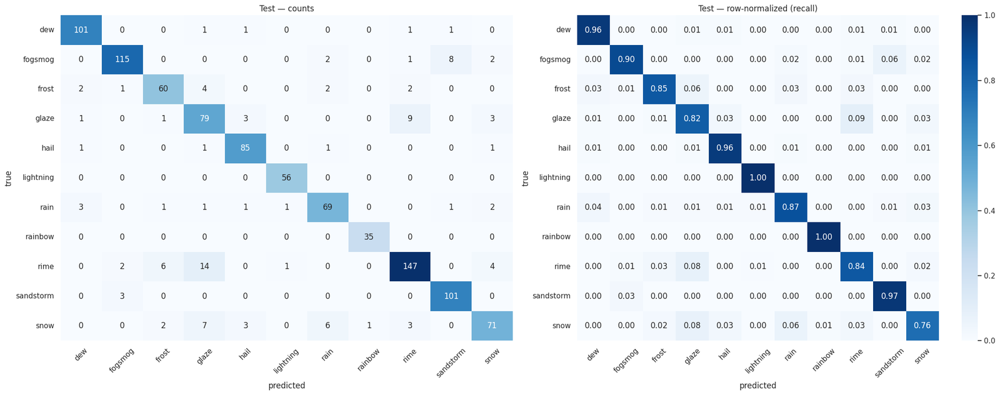
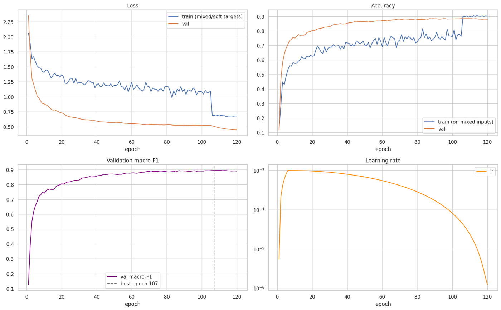
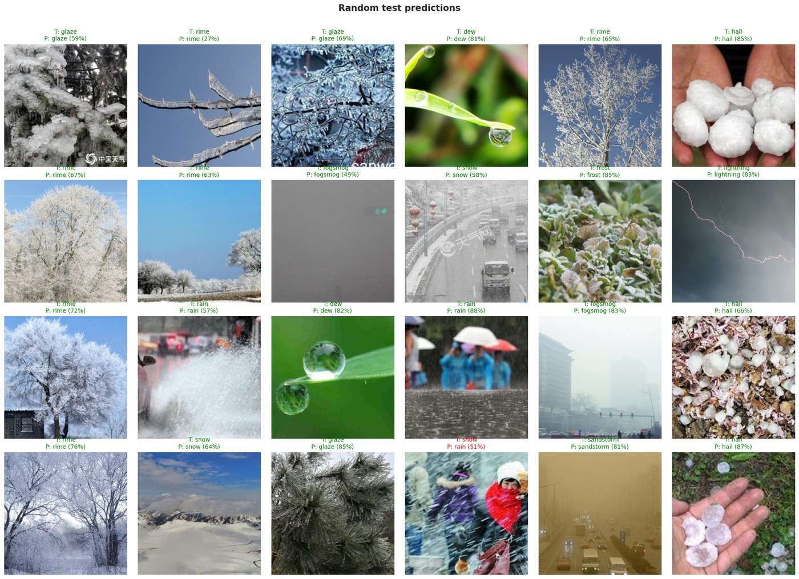

# FastViT from Scratch: Weather Image Classification

A PyTorch reimplementation of [FastViT](https://arxiv.org/abs/2303.14189) (Apple, ICCV 2023), trained **from random init** (no pretrained weights) on 11 weather classes.

## Results (hold-out test set)

| Accuracy | Macro F1 | Top-3 Acc | Macro ROC-AUC |
|:-:|:-:|:-:|:-:|
| 89.2% | 0.899 | 98.6% | 0.992 |

Hardest confusions are between visually similar ice classes: glaze ↔ rime ↔ frost, and snow.

## Structural reparameterization

At inference, every multi-branch block (MobileOne, RepMixer, RepCPE, large-kernel conv) is folded into a single conv. The output is the same function (max logit diff 3.6e-6) with fewer layers:

| | Train-time | Reparameterized |
|---|:-:|:-:|
| Conv layers | 75 | 59 |
| BN layers | 74 | 14 |
| Latency, T4, batch 1 | 10.0 ms | **5.7 ms (1.76×)** |
| Latency, CPU, batch 1 | 214 ms | **129 ms (1.67×)** |

Parameter counts of all 7 variants (T8 → MA36) match the `timm` reference.

## Training

- **Model**: `fastvit_sa12`, 10.6M params, 3.0 GFLOPs
- **Data**: [Weather Image Recognition](https://www.kaggle.com/datasets/jehanbhathena/weather-dataset), 6,862 images, stratified 70/15/15 split
- **Recipe**: 120 epochs, AdamW (lr 1e-3, wd 0.05), warmup + cosine, Mixup/CutMix (disabled for the last 15 epochs), label smoothing, class-weighted loss, EMA, drop path, TrivialAugment, AMP, hflip TTA

## Run

Open `weather_fastvit_from_scratch.ipynb` on Kaggle, add the dataset, select a **GPU T4** and run all.
